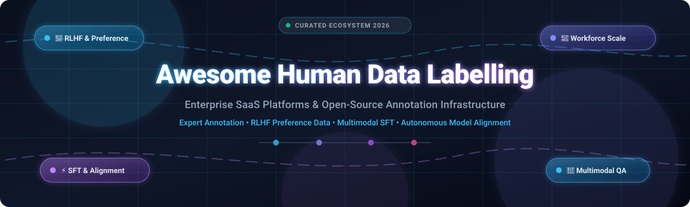

<div align="center">



# 🏷️ Awesome Human Data Labelling

[](https://github.com/ishandutta2007/Awesome-Awesome-Awesome)
[](https://discord.gg/jc4xtF58Ve)
[](https://github.com/ishandutta2007/Awesome-Human-Data-Labelling/pulls)
[](https://github.com/ishandutta2007/Awesome-Human-Data-Labelling/graphs/commit-activity)
[](https://github.com/ishandutta2007/Awesome-Human-Data-Labelling/stargazers)
<a href="https://github.com/ishandutta2007"></a>

<p align="center">
  <strong>Curated Directory of Enterprise SaaS Platforms &amp; Open-Source Toolkits for AI Data Annotation, RLHF Preference Tuning &amp; Workforce Operations</strong>
</p>

<p align="center">
  <a href="#-sector-overview--market-dynamics">Market Overview</a> •
  <a href="#-saashosted-platforms">SaaS Platforms</a> •
  <a href="#-open-source-github-projects">Open-Source Projects</a> •
  <a href="#-how-to-contribute">Contributing</a> •
  <a href="#-star-history">Star History</a> •
  <a href="#-support--sponsorship">Support</a>
</p>

</div>

---

## 📖 Introduction &amp; SEO Meta

Welcome to the definitive guide to **Human Data Labelling**, **RLHF (Reinforcement Learning from Human Feedback)**, and **AI Data Annotation Infrastructure**. As generative AI models, multimodal LLMs, and autonomous systems evolve, high-quality human supervision, supervised fine-tuning (SFT) datasets, domain-expert red teaming, and multi-rater consensus evaluation remain the single most critical bottleneck in model performance.

Whether you are seeking enterprise-grade managed workforces or self-hosted, offline-first open-source annotation platforms, this list provides comprehensive technical comparisons, transparent pricing breakdowns, and ecosystem metrics.

---

## 📈 Sector Overview &amp; Market Dynamics

The global data annotation and human data labelling market is valued at approximately **$2.5B–$4.1B in 2025/2026** and is projected to expand beyond **$12B by 2030** at a compound annual growth rate (CAGR) exceeding **25%**. 

The sector exhibits **moderate fragmentation with high concentration at the elite tier**: while thousands of regional BPOs and boutique labeling shops serve routine classification tasks, high-value domain-expert RLHF, multimodal reasoning benchmarks, and frontier lab alignment are heavily concentrated among a handful of well-capitalized leaders (such as Scale AI and Mercor). Concurrently, developer adoption is shifting toward self-hosted open-source tooling (e.g., Label Studio, CVAT, OpenRLHF) to maintain strict IP sovereignty and avoid prohibitive vendor markup on raw data processing.

---

## 📑 Table of Contents

- [📈 Sector Overview &amp; Market Dynamics](#-sector-overview--market-dynamics)
- [🏢 SaaS/Hosted Platforms](#-saashosted-platforms)
- [💻 Open-Source GitHub Projects](#-open-source-github-projects)
- [🤝 How to Contribute](#-how-to-contribute)
- [⭐ Star History](#-star-history)
- [💖 Support &amp; Sponsorship](#-support--sponsorship)
- [⚖️ Disclaimer](#️-disclaimer)

---

## 🏢 SaaS/Hosted Platforms

The following table compares the premier commercial data annotation platforms and managed workforce providers. Entries are **sorted in descending order by enterprise company size (Valuation / Annual Revenue)**.

| 🏢 Platform | 💰 Company Size (Valuation / Revenue) | 🏷️ Starting Tier Pricing | 🎁 Free Tier / Free Trial Limits | 🔍 Core Capabilities &amp; Specialties |
| :--- | :--- | :--- | :--- | :--- |
| **[Mercor](https://mercor.com/)** | ~$20B Valuation ($2B+ Annualized Revenue) | Custom enterprise contracts starting from ~$15,000/pilot SOW | 14-day scoping demo pilot with initial interview pool access | Vetted marketplace of domain specialists (software engineers, doctors, lawyers) for expert evaluation, RL environments, and complex reasoning benchmarks. |
| **[Scale AI](https://scale.com/)** | $13.8B Valuation (~$1B+ Revenue) | Annual enterprise minimum commitments averaging ~$93,000/year (entry SOWs from $50,000/year) | 30-day guided enterprise sandbox / PoC for qualified teams (no self-serve free forever plan) | The category benchmark for frontier LLM RLHF (Outlier, SEAL), autonomous vehicle 3D point cloud LiDAR, multimodal alignment, and government AI data pipelines. |
| **[Turing](https://www.turing.com/)** | ~$4B Valuation ($150M+ ARR) | Scoped project contracts starting from ~$10,000/month | Free discovery session &amp; 14-day trial match for custom domain specialist teams | Global vetted tech talent &amp; domain specialist network for LLM fine-tuning, coding evaluation, STEM reasoning tasks, and custom human-in-the-loop validation. |
| **[Appen](https://appen.com/)** | ~$1.2B Peak MCap ($200M–$250M ARR) | Annual platform subscriptions and managed SOWs starting from ~$5,000/project | 14-day structured software trial with sample data ingestion (managed crowd tasks require paid pilot) | Massive global workforce with 1M+ vetted contributors across 170+ countries; ideal for massive multilingual NLP, speech collection, and classical vision workflows. |
| **[Labelbox](https://labelbox.com/)** | ~$1B Valuation ($50M+ ARR) | Free forever plan ($0/mo); Starter pay-as-you-go at $0.10 per LBU (Labelbox Unit) | **Free Forever Plan**: 500 LBU credits/month, up to 30 seats, 1,500 API calls/min, full multimodal labeling &amp; catalog indexing | Best-in-class hybrid tooling platform: self-service software, model-assisted annotation (Foundry), and flexible outsourced workforce (Boost). |
| **[Sama](https://sama.com/)** | ~$350M Valuation ($60M+ ARR) | Managed enterprise projects starting at ~$10,000/pilot | 14-day platform demo &amp; tailored pilot workflow assessment (no permanent free tier due to ethical in-house workforce) | Ethical AI data partner with in-house delivery centers across East Africa, North America, and Europe; deep domain expertise in automotive computer vision, robotics, and medical imaging. |
| **[Surge AI](https://www.surgehq.ai/)** | ~$300M Valuation ($40M+ ARR) | Custom expert RLHF packages starting from ~$5,000–$10,000/engagement | Scoped trial review batch (up to 100 sample annotations upon sales qualification) | Elite RLHF and LLM preference specialist with rigorous multi-rater consensus, dialect-specific linguists, and advanced prompt engineering/red teaming workforces. |
| **[SuperAnnotate](https://www.superannotate.com/)** | ~$150M Valuation ($20M+ ARR) | Free forever plan ($0/mo); Starter/Pro tiers starting at ~$62/user/month | **Free Forever Plan**: Up to 3 user seats, 1,000 compute/orchestration hours, core multimodal vector &amp; pixel editors | Complete AI data orchestration platform featuring interactive vector/pixel editors, LLM fine-tuning suites, active learning pipelines, and Python SDK. |
| **[iMerit](https://imerit.net/)** | ~$120M Valuation ($35M+ ARR) | Enterprise solution contracts starting from ~$5,000/month | 14-day technical proof-of-concept (PoC) with domain specialist sample batch | High-precision human-in-the-loop workflows for regulated industries: healthcare/pathology, financial services, autonomous technology, and geospatial mapping. |
| **[Toloka](https://toloka.ai/)** | ~$100M Valuation ($30M+ ARR) | Pay-as-you-go task funding (min deposit of $10 into account balance; tasks from $0.01/judgment) | **30-Day Free Trial**: Free account registration with up to $20 in promotional task credits without upfront credit card requirements | Distributed global crowd and on-demand micro-task marketplace; ideal for rapid international NLP, sentiment analysis, search relevance, and multilingual dataset generation. |

---

## 💻 Open-Source GitHub Projects

The following list includes production-ready open-source annotation frameworks, RLHF training engines, and agent-assisted dataset curation platforms. Entries are **sorted in descending order by GitHub_Stars**.

- **[HumanSignal / label-studio](https://github.com/HumanSignal/label-studio)**  
  <a href="https://github.com/HumanSignal/label-studio/stargazers"></a>  
  **The most comprehensive, multi-modal open-source data labeling platform** (Apache-2.0). Supports image, text, audio, video, time-series, and large-scale LLM evaluation (RLHF, dialogue ranking, multi-turn comparisons). Integrates directly with pre-labeling ML backends, active learning loops, and cloud storage (S3, GCS, Azure).

- **[HumanSignal / labelImg](https://github.com/HumanSignal/labelImg)**  
  <a href="https://github.com/HumanSignal/labelImg/stargazers"></a>  
  Classic, lightweight graphical image annotation tool written in Python and Qt (MIT). Specializes in bounding box labeling for object detection in PascalVOC and YOLO formats.

- **[cvat-ai / cvat](https://github.com/cvat-ai/cvat)**  
  <a href="https://github.com/cvat-ai/cvat/stargazers"></a>  
  **The industrial-grade computer vision annotation benchmark** (MIT). Tailor-made for complex vision workflows: 2D polygons, bounding boxes, 3D LiDAR point clouds, video tracking, and automated segmentation via Segment Anything (SAM/SAM2/SAM3) and YOLO models.

- **[wkentaro / labelme](https://github.com/wkentaro/labelme)**  
  <a href="https://github.com/wkentaro/labelme/stargazers"></a>  
  Ubiquitous image polygonal annotation tool inspired by MIT's LabelMe (GPL-3.0). Ideal for semantic segmentation, instance segmentation, and shape polygon tagging with direct export to VOC and COCO formats.

- **[cleanlab / cleanlab](https://github.com/cleanlab/cleanlab)**  
  <a href="https://github.com/cleanlab/cleanlab/stargazers"></a>  
  **The standard data-centric AI library for detecting labeling errors in datasets** (AGPL-3.0). Automatically surfaces mislabeled human annotations, out-of-distribution examples, and noisy labels across image, text, audio, and tabular data using confident learning.

- **[doccano / doccano](https://github.com/doccano/doccano)**  
  <a href="https://github.com/doccano/doccano/stargazers"></a>  
  Open-source text annotation tool for human annotators (MIT). Clean, intuitive web interface designed for Named Entity Recognition (NER), sentiment classification, sequence-to-sequence translation, and text summarization.

- **[OpenRLHF / OpenRLHF](https://github.com/OpenRLHF/OpenRLHF)**  
  <a href="https://github.com/OpenRLHF/OpenRLHF/stargazers"></a>  
  **High-performance distributed RLHF training framework** (Apache-2.0). Engineered on Ray, vLLM, and DeepSpeed. Delivers 1.2x–1.7x throughput gains over legacy frameworks, supporting PPO, DPO, KTO, multi-turn dialogue environments, and custom rule-based/judge reward functions.

- **[argilla-io / argilla](https://github.com/argilla-io/argilla)**  
  <a href="https://github.com/argilla-io/argilla/stargazers"></a>  
  **Open-source platform for LLM data curation and human feedback** (Apache-2.0). Designed specifically for LLM fine-tuning, RAG evaluation, preference collection (DPO/RLHF), prompt engineering, and human-in-the-loop review teams.

- **[vietanhdev / anylabeling](https://github.com/vietanhdev/anylabeling)**  
  <a href="https://github.com/vietanhdev/anylabeling/stargazers"></a>  
  Effortless desktop AI-assisted data labeling tool with seamless support for YOLO, Segment Anything (SAM, SAM 2, MobileSAM), and interactive bounding/polygon drawing.

- **[opendatalab / labelU](https://github.com/opendatalab/labelU)**  
  <a href="https://github.com/opendatalab/labelU/stargazers"></a>  
  Multi-modal data annotation tool (Apache-2.0) supporting image, video, and audio annotation with built-in pre-annotation models, flexible configuration, and customizable export schemas.

- **[xtreme1-io / xtreme1](https://github.com/xtreme1-io/xtreme1)**  
  <a href="https://github.com/xtreme1-io/xtreme1/stargazers"></a>  
  **Multimodal data labeling platform under the LF AI &amp; Data Foundation** (Apache-2.0). Excels at 3D LiDAR point clouds, 2D/3D sensor fusion, image annotation, and conversational LLM RLHF ranking.

- **[opendatalab / LabelLLM](https://github.com/opendatalab/LabelLLM)**  
  <a href="https://github.com/opendatalab/LabelLLM/stargazers"></a>  
  Open-source platform tailored for conversational dataset annotation, prompt tuning, instruction following, and RLHF preference ranking with multi-judge workflows.

- **[midas-research / audino](https://github.com/midas-research/audino)**  
  <a href="https://github.com/midas-research/audino/stargazers"></a>  
  Open-source audio annotation platform for humans (MIT). Purpose-built for acoustic segmentation, speech-to-text transcription, voice activity detection, and audio classification.

- **[jiesutd / YEDDA](https://github.com/jiesutd/YEDDA)**  
  <a href="https://github.com/jiesutd/YEDDA/stargazers"></a>  
  Lightweight collaborative text span annotation tool (ACL 2018 Demo Nomination). Offers keyboard-driven rapid entity span tagging with intelligent recommendation assistance.

- **[inception-project / inception](https://github.com/inception-project/inception)**  
  <a href="https://github.com/inception-project/inception/stargazers"></a>  
  Semantic annotation and knowledge management workbench (Apache-2.0). Supports multi-layer linguistic tagging, named entity linking, and interactive ontology curation.

- **[scalabel / scalabel](https://github.com/scalabel/scalabel)**  
  <a href="https://github.com/scalabel/scalabel/stargazers"></a>  
  Versatile web-based visual data annotation platform built by the BDD (Berkeley DeepDrive) team (Apache-2.0). Provides rich 2D box, tracking, polygon, and 3D bounding box workflows.

- **[SupritYoung / RLHF-Label-Tool](https://github.com/SupritYoung/RLHF-Label-Tool)**  
  <a href="https://github.com/SupritYoung/RLHF-Label-Tool/stargazers"></a>  
  Focused manual response data annotation and comparison sorting tool designed specifically for LLM RLHF ranking and pairwise preference collection.

- **[knowlyr-datalabel](https://pypi.org/project/knowlyr-datalabel/0.3.0/)** *(PyPI Utility)*  
  Offline-first, zero-dependency annotation engine generating standalone HTML interfaces. Features multi-annotator inter-annotator agreement (IAA: Cohen's/Fleiss' Kappa), LLM pre-labeling, and MCP server integrations.

- **[PixLint](https://pypi.org/project/pixlint/)** *(PyPI Utility)*  
  Model Context Protocol (MCP) server equipping AI assistants with automated computer vision dataset diagnostics, label-noise detection, and semantic query capabilities.

---

## 🤝 How to Contribute

Contributions are welcome and greatly appreciated! Follow these steps to submit a tool or update existing benchmarks:

1. **Fork the repository** to your personal GitHub account.
2. **Create a feature branch**:
   ```bash
   git checkout -b feature/add-new-annotation-platform
   ```
3. **Add or modify entries** in `README.md`:
   - For SaaS products, verify starting tier prices and explicit free tier / free trial limits.
   - For open-source repositories, include a valid GitHub Stars_Badge linked to its `/stargazers` page.
4. **Ensure factual accuracy** and include official documentation links.
5. **Submit a Pull Request** with a brief summary of the changes made.

---

## ⭐ Star History

[](https://star-history.dera.page/#ishandutta2007/Awesome-Human-Data-Labelling&type=date&legend=top-left)

---

## 💖 Support &amp; Sponsorship

If this curated ecosystem helps your AI research, data engineering pipelines, or enterprise vendor selection, please consider supporting the project:

- 🌟 **Star this repository** to help others discover it on GitHub.
- 🍴 **Fork and share** with your data engineering and MLOps teams.
- ☕ **Buy me a coffee**: Sponsor directly via the [GitHub Sponsors Dashboard](https://github.com/sponsors/ishandutta2007).

Your support enables continuous updates, verified pricing research, and active maintenance of this community resource!

---

## ⚖️ Disclaimer

- This is a **community-curated index** for informational, architectural, and educational purposes. Inclusion does not imply official endorsement or sponsorship.
- Human data labelling and model evaluation platforms handling sensitive training data must comply with global regulations (GDPR, HIPAA, CCPA, SOC 2 Type II) and enforce robust annotator workforce confidentiality agreements.
- Most enterprise AI development programs deploy **hybrid workflows**: open-source self-hosted platforms (e.g., Label Studio or CVAT) for raw data preprocessing, combined with specialized expert networks (e.g., Surge AI, Scale AI, or Mercor) for frontier alignment and RLHF evaluation.
